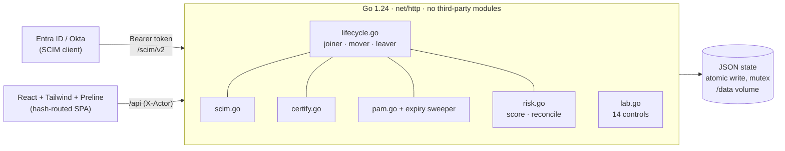

# IAM Projects: an identity governance platform, built and audited

**Live demo: [iam.assafwahinc.com](https://iam.assafwahinc.com)** · Go 1.24 (stdlib only) · React 18 · Tailwind CSS 4 · Preline UI

A working Identity & Access Management platform that does the real jobs of an IAM engineer: identity lifecycle, **SCIM 2.0 provisioning**, access requests with **segregation of duties**, **access certifications**, **just-in-time privileged access**, and **risk-based reconciliation**. Every control is a testable assertion over live state, mapped to **NIST SP 800-53 r5, SOX ITGC, HIPAA and CIS**.


> All people and data are fictional. Product names (Workday, Entra ID, Epic…) only label the *type* of system being simulated; nothing connects to real services.

## What it does

| Module | IAM capability | Engineering highlights |
|---|---|---|
| **Joiner · Mover · Leaver** | Lifecycle management, birthright RBAC | Movers lose all access outside the new role in the same event, including approved exceptions. Leavers end JIT sessions and cancel requests. Manual systems leave an orphan behind, as in real life. |
| **SCIM 2.0 provisioning** | Inbound provisioning from Entra ID / Okta | RFC 7643/7644 `/Users` and `/Groups`, filters (`eq ne co sw ew pr`, `and`), paging, PATCH, discovery endpoints, SCIM error schema. Handles Entra's `"Replace"` / `"False"` quirks. Bearer tokens are 192-bit, stored as SHA-256 hashes, compared in constant time. |
| **Access requests** | Request & approval, SoD | SoD is evaluated when a request is raised; approving a conflict requires a written risk acceptance. |
| **Access reviews** | User access certification (SOX UAR) | Campaigns by scope, routed to managers; revoke on non-response at close; birthright revocations become exclusions so role re-sync honours them; CSV evidence export. |
| **Just-in-time access** | PAM / zero standing privilege | Eligibility with per-assignment max duration, ticket validation (`CHG`/`INC`/`RITM`), a goroutine that sweeps expired grants, 60-minute break-glass with mandatory post-use review. Elevations that would break SoD are refused. |
| **Role matrix** | RBAC engineering | Toggling a cell re-syncs every member; the API refuses roles that would contain both sides of an SoD rule. |
| **Risk & reconciliation** | Orphan / rogue account detection, dormant access | Classifies target-system accounts as orphan, rogue or unowned service account with severity; remediation by disable, assign owner or adopt (refused if it would legitimise an SoD violation). Additive, explainable risk score per identity. |
| **Controls lab** | Continuous control monitoring | 14 controls in [`server/lab.go`](server/lab.go) run after every change, with framework mapping and a downloadable audit write-up. |
| **Audit log** | Evidence | Every action with actor, target and reason; SCIM changes attributed to the token (`scim:<name>`); CSV export. |

The tenant ships with **six deliberate audit findings** (privileged birthright, a manual app, an unreviewed break-glass session, an orphan and an ownerless service account, rogue access that breaks SoD, and a dormant Domain Admin). The lab walks you through fixing each one: **Problem → Assumptions → Build → Test → Improve**.

| Just-in-time access | Risk & reconciliation |
|---|---|
|  |  |
| **Access reviews** | **SCIM 2.0 console** |
|  |  |

## Controls

| ID | Control | Frameworks |
|---|---|---|
| C1 | Terminated identities hold zero access | NIST AC-2(3) · SOX access removal · HIPAA 164.308(a)(3)(ii)(C) |
| C2 | Role-based access matches the current role | NIST AC-2, AC-6 · SOX access modification |
| C3 | Every extra grant has an approved request | NIST AC-2(1) · SOX provisioning approval |
| C4 | SoD conflicts have a documented risk acceptance | NIST AC-5 · SOX segregation of duties |
| C5 | No role bakes in an SoD conflict | NIST AC-5, AC-6 |
| C6 | Privileged access is requested, not birthright | NIST AC-6(5), AC-6(1) · CIS 5.4 |
| C7 | Every system is owned and automatically provisioned | NIST CM-8, AC-2(1) |
| C8 | Expired JIT elevations are removed | NIST AC-2(2), AC-6(5) |
| C9 | Every break-glass session is reviewed | NIST AC-2(4), AU-6 · HIPAA 164.312(a)(2)(ii) |
| C10 | No orphaned or ownerless accounts in target systems | NIST AC-2(3), IA-4 |
| C11 | No access granted directly in apps, outside IAM | NIST AC-2, AC-6 |
| C12 | Standing privileged access is used within 90 days | NIST AC-2(3), AC-6(7) |
| C13 | Access reviews finish by their due date | NIST AC-2(j) · SOX user access review · HIPAA 164.308(a)(4)(ii)(C) |
| C14 | Provisioning tokens are rotated within 90 days | NIST IA-5(1), SC-12 |

Reasoning for each mapping: [`docs/CONTROLS.md`](docs/CONTROLS.md).

## Architecture



- **One lifecycle code path.** The JML screen and SCIM call the same functions, so an IdP push is governed exactly like an analyst action.
- **Controls as code.** Each control is a pure function over state, unit-tested in [`server/features_test.go`](server/features_test.go) and [`server/lifecycle_test.go`](server/lifecycle_test.go), including time travel through a swappable clock for JIT expiry and overdue reviews.
- **Storage.** A single JSON document behind a `Store` type (write to tmp, then rename, under a mutex). Swappable for Postgres without touching handlers.
- **Deploy.** A multi-stage Dockerfile builds a small Alpine image serving the API and SPA on port 8080, deployed on Coolify behind a Cloudflare tunnel.

## Try it in 2 minutes

1. Open the [**Controls lab**](https://iam.assafwahinc.com/#lab): 8 of 14 controls pass.
2. **Risk & reconciliation → Reconciliation**: disable `mlee.clinical` (rogue Epic access that breaks sod-4). C11 improves and Marcus Lee's risk drops from 60.
3. **Just-in-time access**: review Yusuf's break-glass session (C9 passes), then activate his ServiceNow admin for 5 minutes and watch it expire.
4. **SCIM 2.0**: generate a token, *Create user*, then *Deactivate, Entra style*. Check the audit log for `scim:` entries.

Or from a terminal (after generating a token in the UI):

```bash
TOKEN=scim_...   BASE=https://iam.assafwahinc.com/scim/v2
curl -s "$BASE/Users?filter=userName%20eq%20%22omar.farouk@demo.local%22" -H "Authorization: Bearer $TOKEN"
curl -s -X PATCH "$BASE/Users/ID-1" -H "Authorization: Bearer $TOKEN" -H 'Content-Type: application/scim+json' \
  -d '{"schemas":["urn:ietf:params:scim:api:messages:2.0:PatchOp"],"Operations":[{"op":"Replace","path":"active","value":"False"}]}'
```

More in [`docs/SCIM.md`](docs/SCIM.md). Reset the demo any time from the home screen or with `POST /api/reset`.

## Run locally

```bash
docker compose up --build                 # → http://localhost:8080

# or, for development
cd server && go test ./... && go run .    # API on :8080
cd web && npm install && npm run dev      # UI on :5173, proxies /api and /scim
```

| Variable | Default | Purpose |
|---|---|---|
| `PORT` | `8080` | HTTP port |
| `DATA_PATH` | `./data/iam.json` (`/data/iam.json` in Docker) | Persisted state |
| `STATIC_DIR` | `../web/dist` (`/app/web` in Docker) | Built SPA |

## API

<details>
<summary>REST endpoints (<code>/api</code>, actor from <code>X-Actor</code>)</summary>

| Method | Path | Purpose |
|---|---|---|
| GET | `/summary` · `/catalog` · `/identities` · `/identities/{id}/access` · `/systems` · `/audit` | Read models |
| POST | `/jml/joiner` · `/jml/mover` · `/jml/leaver` | Lifecycle events |
| GET/POST | `/requests` · `/requests/{id}/approve` · `/requests/{id}/deny` | Access requests (reason required for SoD) |
| PUT | `/roles/{id}/entitlements` | Edit role, re-sync members (SoD-blocked) |
| POST | `/grants/revoke` | Remove one grant with a reason |
| GET/POST | `/certifications` · `/certifications/{id}` · `/certifications/{id}/items/{itemId}` · `/certifications/{id}/close` | Access reviews |
| GET/POST | `/pam` · `/pam/elevate` · `/pam/sessions/{id}/revoke` · `/pam/sessions/{id}/review` | JIT and break-glass |
| POST/DELETE | `/pam/eligibility` | Manage eligibility |
| GET/POST | `/risk` · `/reconciliation` · `/reconciliation/accounts/{id}` | Risk scores, drift, remediation |
| GET/POST/DELETE | `/scim/tokens` · `/scim/tokens/{id}` | Provisioning credentials |
| GET | `/lab/checks` | Run all 14 controls |
| POST | `/reset` | Reseed the demo tenant |

</details>

<details>
<summary>SCIM 2.0 endpoints (<code>/scim/v2</code>, bearer token)</summary>

`GET /ServiceProviderConfig` · `GET /ResourceTypes` · `GET /Schemas` · `GET|POST /Users` · `GET|PUT|PATCH|DELETE /Users/{id}` · `GET /Groups` · `GET|PATCH /Groups/{id}`

</details>

## Repository

```
server/   Go API: main.go (routes) · lifecycle.go · scim.go · certify.go · pam.go · risk.go · lab.go · seed.go · store.go · *_test.go
web/      React SPA: src/App.jsx (shell + nav) · src/ui.jsx (Preline-backed kit) · src/pages/*.jsx (one per module)
docs/     LAB-FRAMEWORK.md · CONTROLS.md · SCIM.md · IAM-CONCEPTS.md · DEPLOY-COOLIFY.md
```

## Ideas to extend

OIDC login so approvers are authenticated people · Postgres storage · outbound SCIM connectors to real apps · approval workflows for high-risk JIT roles · peer-group outlier analysis for risk · OAuth 2.0 client credentials for SCIM.

---

Built by **Yassin**: IAM engineering, identity governance, and full-stack development.
