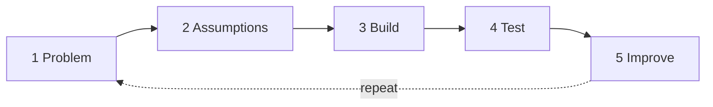

# IAM Projects — a mini Identity & Access Management lab

A small, working IAM platform that runs the four everyday jobs of an IAM analyst / engineer:

| Module | IAM job | What you can do |
| --- | --- | --- |
| **JML workflow** | Identity lifecycle (Joiner · Mover · Leaver) | Onboard a hire, transfer them to a new role, terminate them. Birthright access is granted and revoked automatically from the role. |
| **Access request** | Request & approval governance | Request access outside your role, approve or deny it. Segregation-of-duties (SoD) conflicts are flagged and need a written risk acceptance. |
| **Role matrix** | RBAC design / least privilege | Roles × entitlements grid. Toggle a cell and every active member is re-synced. Roles that would contain an SoD conflict are blocked. |
| **System map** | Application inventory & integrations | HR source → IdP → directory and apps, with auth protocol (SAML / OIDC / LDAP), provisioning method (SCIM / API / manual), owner, criticality and user counts. |
| **Audit log** | Evidence for audits and access reviews | Every grant, revoke, decision and role change, filterable and exportable to CSV. |
| **Lab guide** | Practice the lifecycle, not perfection | Each module walked through **Problem → Assumptions → Build → Test → Improve**, 7 live control checks, visuals for AuthN vs AuthZ, policy bindings and resource hierarchy, and a downloadable lab write-up. See [`docs/LAB-FRAMEWORK.md`](docs/LAB-FRAMEWORK.md). |



All people and data are fictional demo data. Product names (Workday, Entra ID, etc.) only label the *type* of system being simulated — nothing connects to real services.

---

## Stack

```
React 18 (Vite)  ──►  Go 1.24 REST API (stdlib net/http)  ──►  JSON data file on a Docker volume
```

- **Frontend** – `web/` · React + Vite, `lucide-react` icons, plain CSS. Hash routing (`#jml`, `#requests`, `#roles`, `#systems`, `#audit`).
- **Backend** – `server/` · Go standard library only (no third‑party modules), so the build is tiny and reproducible.
- **Storage** – a single JSON document written atomically (`write tmp → rename`) under a mutex to `/data/iam.json`. Behind a small `Store` type, so it can be swapped for SQLite or Postgres later without touching the handlers.
- **Deploy** – one multi‑stage `Dockerfile` → ~20 MB Alpine image serving the API and the built React app on port `8080`.

```
iam-projects/
├── Dockerfile              # web build → go build → alpine runtime
├── docker-compose.yml      # local run with a named volume
├── server/
│   ├── main.go             # HTTP routes + JML / request / role logic
│   ├── store.go            # domain types, JSON store, SoD + grant helpers
│   └── seed.go             # demo tenant (10 systems, 18 entitlements, 7 roles, 7 people, 4 SoD rules)
├── web/
│   └── src/
│       ├── App.jsx         # home screen (the 4 project cards) + navigation
│       └── pages/          # JML.jsx · Requests.jsx · RoleMatrix.jsx · SystemMap.jsx · Audit.jsx
└── docs/
    ├── LAB-FRAMEWORK.md    # Problem → Improve per module, visuals, controls
    ├── IAM-CONCEPTS.md     # how each module maps to real IAM work
    └── DEPLOY-COOLIFY.md   # step-by-step Coolify deployment
```

## Run it locally

```bash
# Option A – Docker
docker compose up --build        # → http://localhost:8080

# Option B – dev mode (hot reload)
cd server && go run .            # API on :8080, data in server/data/iam.json
cd web && npm install && npm run dev   # UI on :5173, proxies /api to :8080
```

Environment variables (all optional):

| Variable | Default | Purpose |
| --- | --- | --- |
| `PORT` | `8080` | HTTP port |
| `DATA_PATH` | `./data/iam.json` (`/data/iam.json` in Docker) | Where state is persisted |
| `STATIC_DIR` | `../web/dist` (`/app/web` in Docker) | Built React app |

Use **Reset demo data** on the home screen (or `POST /api/reset`) to go back to the seed tenant.

## API

| Method | Path | Body | Does |
| --- | --- | --- | --- |
| GET | `/api/health` | – | Liveness check |
| GET | `/api/summary` | – | Counts for the home screen |
| GET | `/api/catalog` | – | Roles, systems, entitlements, SoD rules |
| GET | `/api/identities` | – | Directory with grant counts |
| GET | `/api/identities/{id}/access` | – | Current grants (source: `role` or `request`) |
| GET | `/api/jml/events` | – | Lifecycle history |
| POST | `/api/jml/joiner` | `{name, title, manager, roleId, email?, startDate?}` | Create identity + birthright access |
| POST | `/api/jml/mover` | `{identityId, newRoleId, newTitle?}` | Swap role; revoke what the new role doesn't include |
| POST | `/api/jml/leaver` | `{identityId, endDate?}` | Disable, revoke all, cancel open requests |
| GET | `/api/requests` | – | All access requests |
| POST | `/api/requests` | `{identityId, entitlementId, justification}` | New request (SoD checked) |
| POST | `/api/requests/{id}/approve` | `{reason}` | Approve → provision. Reason **required** if SoD flagged |
| POST | `/api/requests/{id}/deny` | `{reason}` | Deny |
| PUT | `/api/roles/{id}/entitlements` | `{entitlementId, granted}` | Edit role; re-sync members |
| GET | `/api/systems` | – | System inventory with user / privileged counts |
| GET | `/api/audit` | – | Latest 200 audit entries |
| GET | `/api/lab/checks` | – | Run the 7 IAM control checks (pass/fail + findings) |
| POST | `/api/reset` | – | Reseed demo tenant |

The `X-Actor` header sets who is recorded in the audit log (the UI sends `yassin.iam`).

## Deploy on Coolify

See [`docs/DEPLOY-COOLIFY.md`](docs/DEPLOY-COOLIFY.md). Short version: **New Resource → Public Repository → this repo → Build Pack: Dockerfile → Port 8080 → add a persistent volume at `/data` → Deploy.**

## Ideas to extend

- Swap the JSON store for Postgres; add Redis for a request-notification queue.
- Quarterly **access certification** campaigns (manager reviews each grant: keep / revoke).
- Time-boxed privileged access that expires automatically.
- Real SCIM 2.0 `/Users` and `/Groups` endpoints so an IdP can push to this app.
- OIDC login so approvers are real, authenticated people.
